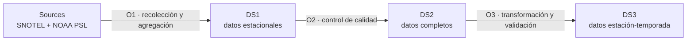

# ENSO y SWE en el Pacific Northwest

[Leer esta documentación en español](README.md).

Este proyecto estudia cómo cambia la relación entre **ENSO** (anomalía de
temperatura del mar en Niño 3.4) y **SWE** (agua almacenada en la nieve) según
la zona y la elevación de las estaciones SNOTEL.

## Flujo de datos



- **O1 / DS1:** datos mensuales convertidos a temporadas diciembre–abril.
  SWE se agrega con el máximo y ENSO con la media.
- **O2 / DS2:** se eliminan temporadas incompletas y estaciones con menos de
  30 temporadas completas.
- **O3 / DS3:** `SWE` se transforma con `log1p`; la elevación se mantiene
  numérica hasta definir bandas globales fijas y se contrasta la asociación
  zona-elevación antes de considerar un modelo inferencial.

Los resultados son exploratorios: existen heterocedasticidad, no normalidad y
solo 46 valores estacionales de ENSO compartidos por todas las estaciones.

## Archivos

| Archivo | Descripción |
| --- | --- |
| [`data/ds1.csv`](data/ds1.csv) | Salida de O1 |
| [`data/ds2.csv`](data/ds2.csv) | Salida de O2 |
| [`data/ds3.csv`](data/ds3.csv) | Salida de O3 |
| [`src/`](src/) | Scripts reproducibles |
| [`LabFinal_Minguez.tex`](LabFinal_Minguez.tex) | Memoria completa |

Dataset: **[Kaggle — ENSO and SWE by zone and elevation (PNW)](https://www.kaggle.com/datasets/nicomnguez/enso-and-swe-by-zone-and-elevation-pnw)**.

## Ejecución

```bash
pip install -r requirements.txt
python src/o1/ds1.py
python src/o2/ds2.py
python src/o3/ds3.py
```
