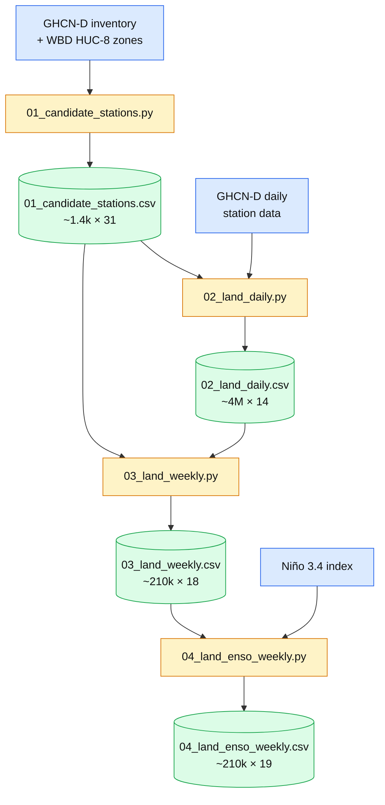
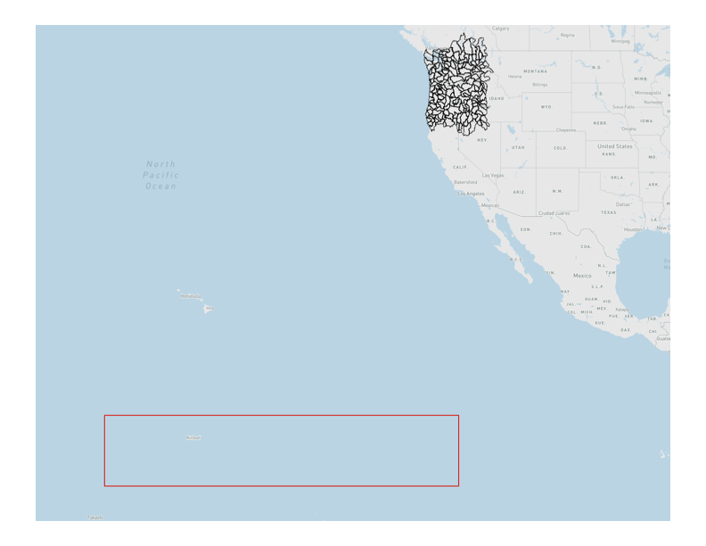

# El Niño and Pacific Northwest Snowfall

Builds a weekly winter dataset (Nov–Mar, 1981 onward) of snow and weather by station, with the Niño 3.4 index, to study El Niño's effect on snowfall.

## Pipeline

Blue = sources, orange = scripts, green = CSVs (rows × columns, approximate).

Run the scripts in order from `src/`. Filters are set in `config/station_filter.json`.

## Sources

1. **Zones:** USGS Watershed Boundary Dataset (HUC-8). https://prd-tnm.s3.amazonaws.com/index.html?prefix=StagedProducts/Hydrography/WBD/National/
2. **Land data:** NOAA NCEI GHCN-Daily. https://www.ncei.noaa.gov/products/land-based-station/global-historical-climatology-network-daily
3. **Ocean data:** NOAA PSL monthly Niño 3.4 index (ERSST v5). https://psl.noaa.gov/data/timeseries/month/Nino34_CPC/

##

