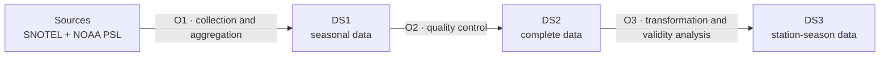

# ENSO and SWE in the Pacific Northwest

[Read this documentation in Spanish](README-ES.md).

This project studies how the relationship between **ENSO** (sea-surface
temperature anomaly in Niño 3.4) and **SWE** (snow water equivalent) changes
depending on the zone and elevation of SNOTEL stations.

## Data pipeline



- **O1 / DS1:** monthly data converted into December–April seasons. SWE is
  aggregated using the maximum and ENSO using the mean.
- **O2 / DS2:** incomplete seasons and stations with fewer than 30 complete
  seasons are removed.
- **O3 / DS3:** `SWE` is transformed with `log1p`; elevation is kept numeric
  until fixed global bands are defined, and zone/elevation association is
  checked before any inferential model is considered.

The results are exploratory: the data show heteroscedasticity and
non-normality, and only 46 seasonal ENSO values are shared by all stations.

## Files

| File | Description |
| --- | --- |
| [`data/ds1.csv`](data/ds1.csv) | O1 output |
| [`data/ds2.csv`](data/ds2.csv) | O2 output |
| [`data/ds3.csv`](data/ds3.csv) | O3 output |
| [`src/`](src/) | Reproducible scripts |
| [`LabFinal_Minguez.tex`](LabFinal_Minguez.tex) | Full report |

Dataset: **[Kaggle — ENSO and SWE by zone and elevation (PNW)](https://www.kaggle.com/datasets/nicomnguez/enso-and-swe-by-zone-and-elevation-pnw)**.

## Running

```bash
pip install -r requirements.txt
python src/o1/ds1.py
python src/o2/ds2.py
python src/o3/ds3.py
```
